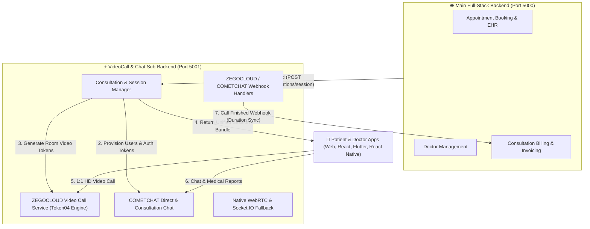

# 🩺 Doctor Video Call & Consultation Chat Sub-Backend
### Integrated with ZEGOCLOUD (Video Calling), COMETCHAT (In-App Messaging) & MongoDB

An enterprise-grade, high-concurrency **Sub-Backend Microservice** built with **Node.js, Express, TypeScript, MongoDB (Mongoose), ZEGOCLOUD, COMETCHAT, and Socket.IO** designed specifically for post-booking doctor consultations and real-time patient-doctor communication.

---

## 🍃 MongoDB Persistence Layer

The service persists all consultation sessions, chat history, participant presence, and duration audit logs to **MongoDB**:

* **`Consultations` Collection**: Stores consultation sessions (`roomId`, `bookingId`, `doctorId`, `patientId`, `status`, `startedAt`, `endedAt`, `durationSeconds`, `participants`, `isSyncedWithMainBackend`).
* **`ChatMessages` Collection**: Stores consultation chat history with compound index `{ roomId: 1, createdAt: -1 }` for paginated retrieval.
* **`CallLogs` Collection**: Stores lifecycle audit events (`initiated`, `accepted`, `rejected`, `ended`, `webhook_received`).

---

## 🏛️ Post-Booking Healthcare Architecture

When a patient books an appointment with a doctor in the main Full-Stack backend, this sub-backend manages the real-time communication lifecycle:



---

## 🔑 Integrated Credentials

Configured in [.env](file:///e:/Doctor-VideoCall&Chat-Backend/.env):

```ini
# ZEGOCLOUD Video Calling Credentials
ZEGO_APP_ID=2065487693
ZEGO_APP_SIGN=65a9d29ab9d889699b95763a8e3da5fa9b9f2e1ba5de5430108411311e50b8d4
ZEGO_CALLBACK_SECRET=65a9d29ab9d889699b95763a8e3da5fa

# COMETCHAT In-App Messaging Credentials
COMETCHAT_APP_ID=1678929173ca5fc8c
COMETCHAT_AUTH_KEY=7777d9d1fbc2f1df8f728714b1919f9ce393a24b
COMETCHAT_REST_API_KEY=9a53fbf903bd310aeb2faa9bb1cf8c5d08aecee4
COMETCHAT_REGION=in
```

---

## 📡 REST API Reference

All endpoints are prefixed with `/api/v1`.

### 1. Post-Booking Consultation Session Creation
Initializes both **ZEGOCLOUD Video Call** and **COMETCHAT 1-on-1 Chat** in a single call after a doctor is booked.

* **Method**: `POST /api/v1/consultations/session`
* **Request Body**:
  ```json
  {
    "bookingId": "bk_98765",
    "doctorId": "doc_sarah_101",
    "doctorName": "Dr. Sarah Jenkins",
    "patientId": "pat_john_202",
    "patientName": "John Miller"
  }
  ```
* **Response (HTTP 201)**:
  ```json
  {
    "success": true,
    "statusCode": 201,
    "message": "Post-booking consultation session created with ZEGOCLOUD Video Call & COMETCHAT Chat",
    "data": {
      "consultationId": "room_bk_98765",
      "bookingId": "bk_98765",
      "status": "scheduled",
      "videoCall": {
        "provider": "zegocloud",
        "appId": 2065487693,
        "appSign": "65a9d29ab9d889699b95763a8e3da5fa9b9f2e1ba5de5430108411311e50b8d4",
        "roomId": "room_bk_98765",
        "patientToken": "04AAAAAGrrp5cAEHk2a...",
        "doctorToken": "04AAAAAGrrp5cAEGpoc...",
        "expiresInSeconds": 7200
      },
      "chat": {
        "provider": "cometchat",
        "appId": "1678929173ca5fc8c",
        "authKey": "7777d9d1fbc2f1df8f728714b1919f9ce393a24b",
        "region": "in",
        "patientAuthToken": "pat_john_202_1793821559...",
        "doctorAuthToken": "doc_sarah_101_1793821559...",
        "patientUid": "pat_john_202",
        "doctorUid": "doc_sarah_101"
      },
      "createdAt": "2026-11-04T19:45:59.979Z"
    }
  }
  ```

---

### 2. Any User Can Chat With Any Doctor (COMETCHAT Direct Chat)
Allows any patient/user to initiate or open direct messaging with any doctor at any time.

* **Method**: `POST /api/v1/consultations/direct-chat`
* **Request Body**:
  ```json
  {
    "userUid": "user_emily_505",
    "userName": "Emily Watson",
    "doctorUid": "doc_alex_303",
    "doctorName": "Dr. Alex Rivera"
  }
  ```
* **Response (HTTP 200)**:
  ```json
  {
    "success": true,
    "statusCode": 200,
    "message": "CometChat direct messaging session initialized successfully",
    "data": {
      "userCredentials": {
        "provider": "cometchat",
        "appId": "1678929173ca5fc8c",
        "authKey": "7777d9d1fbc2f1df8f728714b1919f9ce393a24b",
        "region": "in",
        "userUid": "user_emily_505",
        "userName": "Emily Watson",
        "userAuthToken": "user_emily_505_1793821570...",
        "receiverUid": "doc_alex_303",
        "receiverName": "Dr. Alex Rivera"
      },
      "doctorCredentials": {
        "userUid": "doc_alex_303",
        "userName": "Dr. Alex Rivera",
        "userAuthToken": "doc_alex_303_1793821570..."
      }
    }
  }
  ```

---

### 3. ZEGOCLOUD Video Call Token Refresh
* **Method**: `GET /api/v1/consultations/:roomId/video-token?userId=doc_sarah_101&userName=Dr.+Sarah`
* **Response**:
  ```json
  {
    "success": true,
    "statusCode": 200,
    "data": {
      "provider": "zegocloud",
      "appId": 2065487693,
      "appSign": "65a9d29ab9d889699b95763a8e3da5fa9b9f2e1ba5de5430108411311e50b8d4",
      "roomId": "room_bk_98765",
      "userId": "doc_sarah_101",
      "userName": "Dr. Sarah",
      "token": "04AAAAAGrrp6sAEGhje...",
      "expiresInSeconds": 7200
    }
  }
  ```

---

### 4. Webhooks
* **`POST /api/v1/webhooks/zegocloud`**
  * Verifies signature via `ZEGO_CALLBACK_SECRET`.
  * Detects `room_close` / `stream_delete` events, calculates call duration, and synchronizes with the main backend.
* **`POST /api/v1/webhooks/cometchat`**
  * Receives CometChat delivery and read callbacks.

---

## 💻 Frontend Client Integration Examples

### A. ZEGOCLOUD Video Call (React / Next.js UIKit)
```tsx
import React, { useEffect, useRef } from 'react';
import { ZegoUIKitPrebuilt } from '@zegocloud/zego-uikit-prebuilt';

export const DoctorVideoCall = ({ sessionData, currentUserId, currentUserName }) => {
  const containerRef = useRef(null);

  useEffect(() => {
    const { appId, roomId, patientToken, doctorToken } = sessionData.videoCall;
    const token = currentUserId === sessionData.chat.doctorUid ? doctorToken : patientToken;

    // Initialize ZegoUIKitPrebuilt using backend-generated Token04
    const zp = ZegoUIKitPrebuilt.create(token);

    zp.joinRoom({
      container: containerRef.current,
      scenario: {
        mode: ZegoUIKitPrebuilt.OneONoneCall, // 1-on-1 Doctor-Patient consultation
      },
      showPreJoinView: true,
      turnOnMicrophoneWhenJoining: true,
      turnOnCameraWhenJoining: true,
      showScreenSharingButton: true,
      onLeaveRoom: () => {
        // Handle post-call navigation
        console.log('Call completed');
      },
    });
  }, [sessionData]);

  return <div ref={containerRef} style={{ width: '100vw', height: '100vh' }} />;
};
```

### B. COMETCHAT In-App Messaging (React / Web SDK)
```typescript
import { CometChat } from '@cometchat/chat-sdk-javascript';

// 1. Initialize CometChat with credentials from backend
const appSettings = new CometChat.AppSettingsBuilder()
  .subscribePresenceForAllUsers()
  .setRegion('in')
  .autoEstablishSocketConnection(true)
  .build();

await CometChat.init('1678929173ca5fc8c', appSettings);

// 2. Login user using the AuthToken returned by POST /api/v1/consultations/session
await CometChat.login(sessionData.chat.patientAuthToken);

// 3. Send text message directly to Doctor
const textMessage = new CometChat.TextMessage(
  sessionData.chat.doctorUid,
  "Hello Doctor, I have uploaded my blood test report.",
  CometChat.RECEIVER_TYPE.USER
);

const sentMessage = await CometChat.sendMessage(textMessage);
console.log('Message sent:', sentMessage);
```

---

## 🚦 Available Scripts

```bash
# Start development server with live reload
npm run dev

# Compile TypeScript production build into dist/
npm run build

# Start production server
npm start

# Type check without emitting files
npm run lint
```
