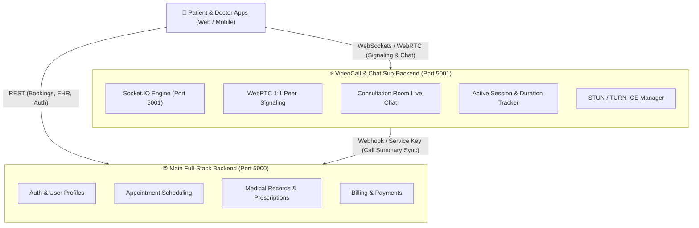

# 🩺 Doctor Video Call & Consultation Chat Sub-Backend

An enterprise-grade, high-concurrency **Sub-Backend Microservice** built with **Node.js, Express, TypeScript, and Socket.IO** tailored specifically for Doctor-Patient real-time telemedicine consultations, WebRTC peer signaling, and live consultation messaging.

---

## 🏛️ System Architecture Context

In a modern healthcare full-stack architecture, high-frequency, real-time media signaling and ephemeral chat workloads are decoupled from the core monolithic backend to ensure zero impact on primary database transactions and EHR records:



### Separation of Responsibilities
* **Main Full-Stack Backend**: User credentials, appointment booking, medical history, electronic health records (EHR), and payments.
* **This Sub-Backend Service**:
  * Ultra-low latency WebRTC peer-to-peer signaling (SDP offer/answer exchange, ICE trickle).
  * In-consultation real-time text chat, file attachment links, typing states, and read receipts.
  * Real-time participant state tracking (mic mute, camera toggle, screen sharing).
  * Session lifecycle and duration tracking with automated webhook synchronization back to the main backend when a consultation ends.

---

## ✨ Features & Capabilities

* **Strict TypeScript**: Configured with strict null checks, no implicit any, and modern ES2022 module resolution.
* **WebRTC 1-to-1 Signaling**: Turnkey signaling protocol for doctor-patient video and audio calls.
* **Real-time Consultation Chat**: Room-based chat with typing indicators, read receipts, and attachment metadata.
* **Turnkey STUN/TURN Discovery**: Dynamic endpoint delivering ICE server configurations to frontend clients.
* **Inter-Service Authentication**: Protected internal routes secured via `x-service-api-key` header.
* **JWT Client Verification**: Handshake authentication verifying tokens issued by the main backend.
* **Defensive Resilience**: Helmet security headers, configurable CORS, Zod request validation, centralized error handling, and graceful process shutdown (`SIGTERM`/`SIGINT`).
* **Docker Ready**: Multi-stage, non-root Alpine container setup.

---

## 📁 Project Structure

```
├── .env.example              # Template environment variables
├── .gitignore                # Git ignore configuration
├── .npmrc                    # Script shell runner config
├── Dockerfile                # Multi-stage production container
├── package.json              # Dependencies and scripts
├── tsconfig.json             # Strict TypeScript compiler options
└── src/
    ├── app.ts                # Express application configuration & middleware
    ├── server.ts             # HTTP + Socket.IO server entrypoint & graceful shutdown
    ├── config/
    │   ├── env.ts            # Zod-validated environment configuration
    │   └── logger.ts         # Winston structured logger
    ├── constants/
    │   ├── events.ts         # Strongly-typed Socket.IO event names
    │   └── roles.ts          # Doctor, Patient, Admin, Service role definitions
    ├── controllers/
    │   ├── chat.controller.ts     # Consultation message history endpoints
    │   ├── health.controller.ts   # Liveness & memory probes
    │   ├── room.controller.ts     # Room lifecycle and validation
    │   └── webrtc.controller.ts   # STUN/TURN configuration provider
    ├── middleware/
    │   ├── auth.middleware.ts        # Client JWT validator
    │   ├── errorHandler.ts           # Central error formatting middleware
    │   ├── notFoundHandler.ts        # 404 handler
    │   ├── serviceAuth.middleware.ts # Service-to-service API key validator
    │   └── validateRequest.ts        # Zod schema validation middleware
    ├── routes/
    │   ├── chat.routes.ts     # /api/v1/chat
    │   ├── health.routes.ts   # /api/v1/health
    │   ├── index.ts           # Route aggregator
    │   ├── room.routes.ts     # /api/v1/rooms
    │   └── webrtc.routes.ts   # /api/v1/webrtc
    ├── services/
    │   ├── chat.service.ts            # Message storage and retrieval
    │   ├── mainBackendSync.service.ts # Webhook sync with main backend
    │   ├── room.service.ts            # Consultation room state manager
    │   └── webrtc.service.ts          # ICE servers provider
    ├── sockets/
    │   ├── chat.handler.ts            # Live chat message events
    │   ├── signaling.handler.ts       # WebRTC signaling events
    │   ├── socketAuth.middleware.ts   # Socket connection authenticator
    │   └── socketManager.ts           # Socket.IO orchestrator
    ├── types/
    │   ├── auth.types.ts     # User & Auth payloads
    │   ├── chat.types.ts     # Message & Attachment structures
    │   ├── room.types.ts     # Room & Participant models
    │   └── socket.types.ts   # Socket event payload types
    ├── utils/
    │   ├── ApiError.ts       # Custom operational error class
    │   ├── ApiResponse.ts    # Standard JSON response format
    │   └── asyncHandler.ts   # Async route wrapper
    └── validations/
        ├── chat.validation.ts # Chat schema validations
        └── room.validation.ts # Room schema validations
```

---

## 🚀 Getting Started

### Prerequisites
* **Node.js**: v20+ or v22+ (tested on Node v24)
* **npm**: v10+

### 1. Installation
```bash
npm install
```

### 2. Environment Setup
Copy the sample environment file:
```bash
cp .env.example .env
```

Configure your `.env`:
```ini
NODE_ENV=development
PORT=5001
CORS_ORIGIN=http://localhost:3000,http://localhost:5173
JWT_SECRET=doctor_videocall_subbackend_super_secret_jwt_key_2026
MAIN_BACKEND_URL=http://localhost:5000
SERVICE_API_KEY=telemedicine_subservice_internal_secure_key_12345
LOG_LEVEL=info
STUN_SERVERS=stun:stun.l.google.com:19302,stun:stun1.l.google.com:19302
```

### 3. Development Mode
Run with hot-reloading via `tsx`:
```bash
npm run dev
```

### 4. Production Build & Execution
```bash
npm run build
npm start
```

---

## 📡 REST API Reference

All REST endpoints are prefixed with `/api/v1`.

### 1. Health & Diagnostics
* **`GET /api/v1/health`**
  * Returns service uptime, memory metrics, and status.

### 2. Consultation Rooms
* **`POST /api/v1/rooms`**
  * Initializes a consultation room.
  * Request Body:
    ```json
    {
      "doctorId": "doc_123",
      "patientId": "pat_456",
      "appointmentId": "apt_789",
      "doctorName": "Dr. Sarah Smith",
      "patientName": "John Doe"
    }
    ```
* **`GET /api/v1/rooms/:roomId`**
  * Retrieves details, active participants, and call status of a room.
* **`GET /api/v1/rooms/:roomId/validate?userId=...`**
  * Checks if a user is permitted to enter the consultation room.
* **`POST /api/v1/rooms/:roomId/end`**
  * Terminates the consultation room, computes call duration, and synchronizes with the main backend.

### 3. Consultation Chat
* **`GET /api/v1/chat/:roomId/messages?limit=50&page=1`**
  * Retrieves chronological message history for a consultation room.

### 4. WebRTC Configuration
* **`GET /api/v1/webrtc/ice-servers`**
  * Retrieves configured STUN/TURN ICE servers for `RTCPeerConnection`.

---

## ⚡ Socket.IO Real-Time Protocol

Connect to `ws://localhost:5001` (or `http://localhost:5001`) with handshake auth:
```javascript
import { io } from 'socket.io-client';

const socket = io('http://localhost:5001', {
  auth: {
    token: '<USER_JWT_TOKEN>',
    // Or in development:
    user: { id: 'doc_123', name: 'Dr. Sarah Smith', role: 'doctor' }
  }
});
```

### 1. Room Management
| Event | Direction | Payload | Description |
|---|---|---|---|
| `room:join` | Client -> Server | `{ roomId }` | Join consultation room |
| `room:join` | Server -> Client | `{ roomId, participants, status }` | Initial room state acknowledgement |
| `room:user-joined` | Server -> Client | `{ participant, roomId }` | Emitted to others when peer joins |
| `room:leave` | Client -> Server | `{ roomId }` | Leave room |
| `room:user-left` | Server -> Client | `{ userId, socketId, roomId }` | Emitted when peer leaves |

### 2. WebRTC Peer Signaling
| Event | Direction | Payload | Description |
|---|---|---|---|
| `call:initiate` | Caller -> Server | `{ roomId, sdp }` | Sends WebRTC Offer |
| `call:incoming` | Server -> Callee | `{ roomId, fromSocketId, fromUser, sdp }` | Delivers incoming call offer |
| `call:answer` | Callee -> Server | `{ roomId, sdp }` | Sends WebRTC Answer |
| `call:accepted` | Server -> Caller | `{ roomId, fromSocketId, fromUser, sdp }` | Delivers answer to caller |
| `call:reject` | Callee -> Server | `{ roomId, reason }` | Declines incoming call |
| `call:rejected` | Server -> Caller | `{ roomId, byUser, reason }` | Informs caller of rejection |
| `call:end` | Either -> Server | `{ roomId }` | Ends active call |
| `call:ended` | Server -> Both | `{ roomId, byUser, durationSeconds }` | Notifies both peers of end |
| `webrtc:ice-candidate` | Either <-> Server | `{ roomId, candidate }` | Trickle ICE candidate relay |
| `webrtc:media-toggle` | Either <-> Server | `{ roomId, type: 'audio'\|'video', enabled }` | Audio mute / camera toggle |
| `webrtc:screen-share` | Either <-> Server | `{ roomId, isSharing }` | Screen share toggle notification |

### 3. Consultation Chat
| Event | Direction | Payload | Description |
|---|---|---|---|
| `chat:send-message` | Client -> Server | `{ roomId, text, attachments }` | Sends chat message |
| `chat:receive-message` | Server -> Room | `ChatMessage` object | Broadcasts message to room |
| `chat:typing-start` | Client -> Server | `{ roomId }` | Peer started typing |
| `chat:typing-stop` | Client -> Server | `{ roomId }` | Peer stopped typing |
| `chat:user-typing` | Server -> Peer | `{ roomId, userId, name, isTyping }` | Relays typing indicator |
| `chat:message-read` | Client <-> Server | `{ roomId }` | Read receipt notification |

---

## 🐳 Docker Deployment

### Build the Docker Image
```bash
docker build -t doctor-videocall-chat-backend:latest .
```

### Run the Container
```bash
docker run -d \
  -p 5001:5001 \
  --name videocall-subbackend \
  -e NODE_ENV=production \
  -e PORT=5001 \
  -e JWT_SECRET=your_production_secret \
  -e MAIN_BACKEND_URL=http://main-backend:5000 \
  -e SERVICE_API_KEY=your_service_api_key \
  doctor-videocall-chat-backend:latest
```

---

## 🤝 Inter-Service Integration with Main Full-Stack Backend

1. **Creating Room on Appointment Booking**:
   When a patient or doctor books an appointment on the main backend, the main backend can issue an internal HTTP call:
   ```http
   POST http://localhost:5001/api/v1/rooms
   Headers:
     x-service-api-key: telemedicine_subservice_internal_secure_key_12345
     Content-Type: application/json
   Body:
     {
       "appointmentId": "apt_1001",
       "doctorId": "doc_200",
       "patientId": "pat_300"
     }
   ```
2. **Synchronizing Consultation Completion**:
   When the call finishes, this sub-backend automatically dispatches a webhook to the main backend:
   ```http
   POST ${MAIN_BACKEND_URL}/api/consultations/call-ended
   Headers:
     x-service-api-key: telemedicine_subservice_internal_secure_key_12345
     Content-Type: application/json
   Body:
     {
       "roomId": "room_cb92a22a",
       "appointmentId": "apt_1001",
       "doctorId": "doc_200",
       "patientId": "pat_300",
       "startedAt": "2026-11-05T01:00:00.000Z",
       "endedAt": "2026-11-05T01:15:20.000Z",
       "durationSeconds": 920
     }
   ```
   The main backend receives the exact call duration to calculate doctor charges, generate consultation billing, and update the appointment status to `COMPLETED`.

---

## 📜 License
ISC License. Designed for production healthcare and telemedicine architectures.
