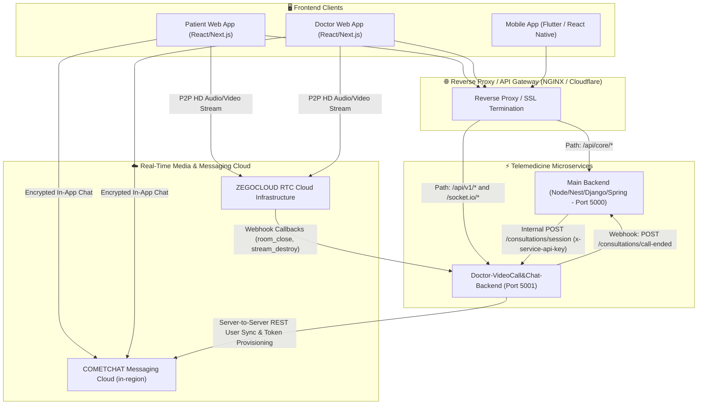

# 🏛️ System Architecture Specification
### Doctor Video Call & Consultation Chat Sub-Backend

This document outlines the architectural design, microservice decomposition, component topology, security layers, and scalability patterns of the **Doctor Video Call & Chat Sub-Backend**.

---

## 1. 🌐 Microservices Decomposition & Boundary Context

In telemedicine systems, separating the real-time audio/video/chat workloads from the primary full-stack backend is an essential architectural decision:

| Dimension | 🌐 Main Full-Stack Backend | ⚡ VideoCall & Chat Sub-Backend |
|---|---|---|
| **Primary Role** | Core business logic, EHR, billing, user accounts | Ephemeral session management, WebRTC signaling, token issuance |
| **Port** | `5000` | `5001` |
| **Workload Type** | High-durability I/O, relational queries, transactional billing | High-throughput, low-latency, real-time WebSockets & token generation |
| **Protocols** | HTTP/REST, GraphQL | WebSockets, WSS, WebRTC, HTTP/REST |
| **3rd-Party Integrations** | Payment gateways (Stripe/Razorpay), Insurance APIs | **ZEGOCLOUD** (Audio/Video), **COMETCHAT** (Messaging) |
| **Session Lifetime** | Persistent user sessions, refresh tokens | Short-lived consultation rooms (15-60 min) |

---

## 2. 🧩 High-Level Component Topology



---

## 3. 📂 Layered Sub-Backend Internal Architecture

The sub-backend follows a decoupled layered architecture:

```
src/
├── app.ts                  # Application Assembly: Helmet, CORS, Compression, Parsers
├── server.ts               # Server Entrypoint: HTTP Server, Socket.IO, Graceful Shutdown
│
├── config/                 # Configuration & Environment
│   ├── env.ts              # Zod Environment Validation (Fail-Fast)
│   └── logger.ts           # Winston Structured Logging
│
├── controllers/            # Transport Handlers (HTTP Request -> Service -> Response)
│   ├── consultation.controller.ts # Post-booking session creation & direct chat
│   ├── room.controller.ts         # Consultation room queries & access validation
│   ├── chat.controller.ts         # Message history endpoints
│   ├── webrtc.controller.ts       # STUN/TURN ICE credentials
│   ├── webhook.controller.ts      # ZegoCloud & CometChat callback handlers
│   └── health.controller.ts       # Diagnostics & Liveness probe
│
├── services/               # Core Business Logic Layer
│   ├── consultation.service.ts    # Orchestrates Zego + CometChat session creation
│   ├── zego.service.ts            # High-level ZEGOCLOUD video call credentials
│   ├── zegoServerAssistant.ts     # Official Token04 AES-256-CBC cryptographic engine
│   ├── cometchat.service.ts       # CometChat REST API, user sync & auth tokens
│   ├── room.service.ts            # Active room state tracker & participant roster
│   ├── chat.service.ts            # Fallback chat message store
│   ├── webrtc.service.ts          # Fallback ICE servers provider
│   └── mainBackendSync.service.ts # Inter-service webhook dispatcher
│
├── sockets/                # Real-Time WebSocket Handlers
│   ├── socketManager.ts           # Socket.IO lifecycle & room assignment
│   ├── socketAuth.middleware.ts   # Handshake JWT authentication
│   ├── signaling.handler.ts       # WebRTC 1:1 Offer, Answer, ICE exchange
│   └── chat.handler.ts            # Live chat typing indicators & delivery
│
├── middleware/             # Cross-Cutting Concerns
│   ├── auth.middleware.ts         # Client JWT validation
│   ├── serviceAuth.middleware.ts  # Internal x-service-api-key validation
│   ├── validateRequest.ts         # Zod schema validation
│   ├── errorHandler.ts            # Centralized API error formatting
│   └── notFoundHandler.ts         # 404 Route handler
│
└── types/ / utils/         # Strongly-typed models, ApiResponse, ApiError, DTOs
```

---

## 4. 🔐 Security Architecture

### A. Secret Protection
* **Server Secrets**: `ZEGO_APP_SIGN`, `ZEGO_CALLBACK_SECRET`, `COMETCHAT_REST_API_KEY`, and `JWT_SECRET` reside strictly on the server in `.env`.
* **Zero Client Exposure**: The client application only ever receives **temporary, scoped, short-lived tokens** (Token04 for ZEGOCLOUD, UserAuthToken for CometChat).

### B. Inter-Service Communication Security
```
[Main Backend] ──(HTTPS + x-service-api-key)──► [Sub-Backend]
```
Requests originating from the main backend are authenticated via `requireServiceAuth` middleware checking the `x-service-api-key` header against `env.SERVICE_API_KEY`.

### C. Webhook Signature Verification
Incoming webhooks from ZEGOCLOUD are verified against tampering using SHA-256 HMAC:
$$\text{Signature} = \text{SHA256}(\text{sort}(\text{secret}, \text{nonce}, \text{timestamp}))$$
If the calculated signature does not match the header, the request is rejected immediately with HTTP 401.

---

## 5. 📈 Scalability & State Management

1. **Stateless Token Generation**:
   - Both ZEGOCLOUD Token04 and CometChat Auth Token generation are completely stateless. Any cluster instance of the sub-backend can issue valid tokens without cross-instance synchronization.
2. **Horizontal Clustering (Socket.IO)**:
   - For high-volume multi-instance deployments, the in-memory `RoomService` and Socket.IO manager can be backed by `@socket.io/redis-adapter` and Redis Key-Value store with zero application code refactoring.
3. **Graceful Shutdown**:
   - Listens on `SIGTERM` and `SIGINT` to gracefully terminate open socket connections, flush Winston logs, and finish pending HTTP requests before exiting with code 0.

