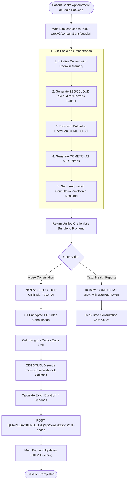
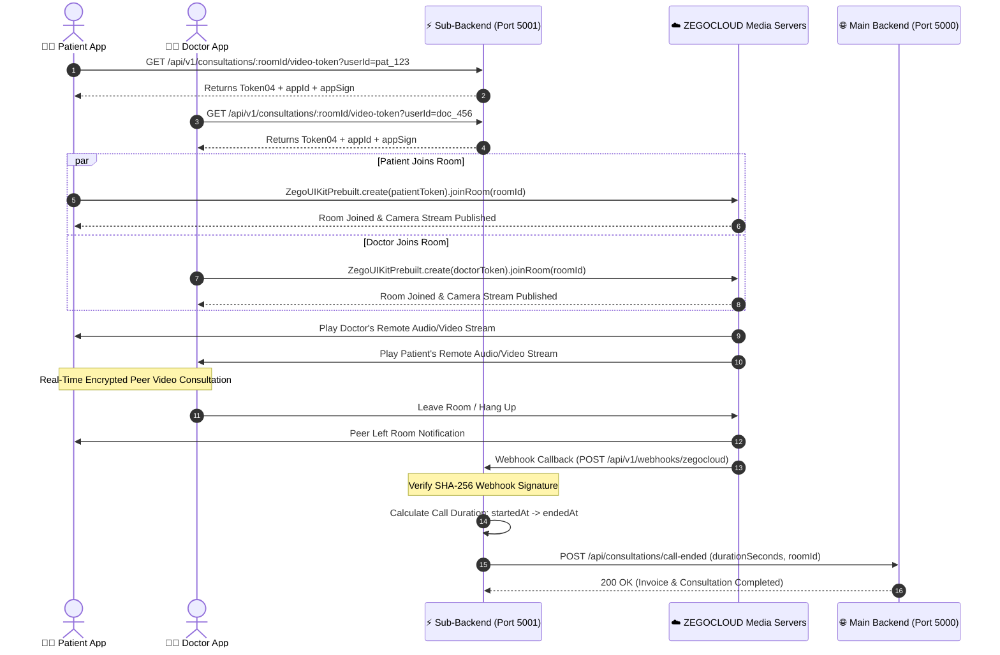
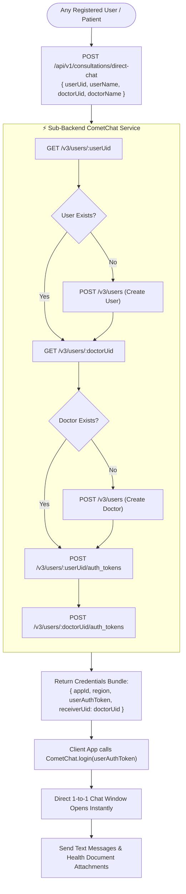
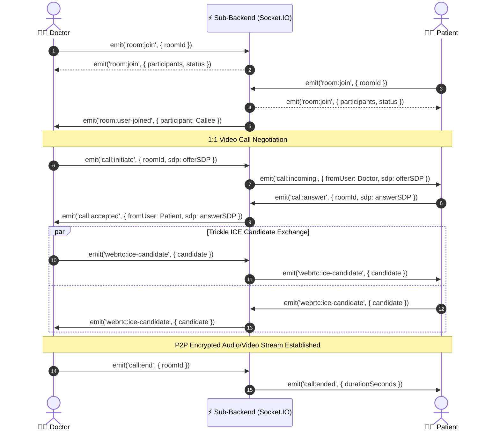
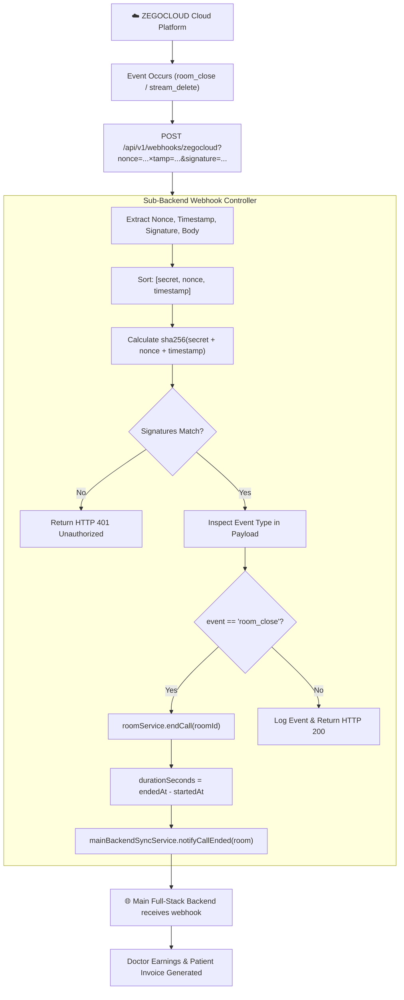

# 📊 System Flowcharts & Visual Architecture
### Doctor Video Call & Consultation Chat Sub-Backend

This document provides visual flowcharts covering all primary system operations, state transitions, and real-time communication pathways.

---

## 1. 🔄 Overall Post-Booking Consultation Lifecycle

---

## 2. 📹 ZEGOCLOUD Video Call Connection & Handshake

---

## 3. 💬 COMETCHAT: "Any User Can Chat With Any Doctor"

---

## 4. ⚡ Native WebRTC Signaling Fallback (Socket.IO)

Used as an in-house real-time signaling fallback when custom WebRTC peer connections are utilized:

---

## 5. 🛡️ ZEGOCLOUD Webhook & Billing Verification Flow

